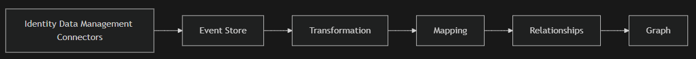
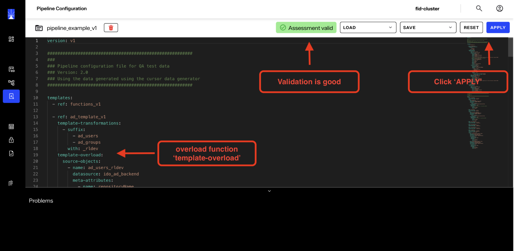
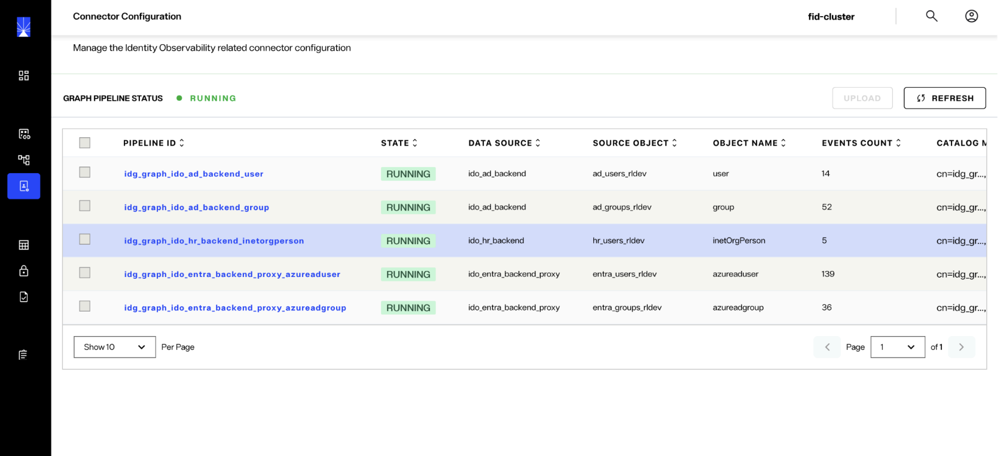

# Datasource Pipelines Configuration

## Overview

-- Remove the word graph -- 

Pipeline configuration is how the identity data gets ingested into the Observability data model. The pipelines configuration is a declarative YAML document that defines the whole data ingestion process, from the sources to the pipeline: which entries are read, how they are transformed, which vertices and edges they become, and how accounts are reconciled with their owners.



Entries are published by Data Sync Config connectors or, for source objects that use a `data-dock` block, read by Data-Dock. The orchestrator validates the configuration when it is assessed or applied, and the pipeline engine builds its execution plan from it.

Do not build your configuration all in one YAML file. Instead, build it using templates, preferably one template per datasource. See the [graph pipeline configuration templates](./template-configuration.md) for more details, and [Pipeline configuration examples](./configuration-examples.md) for a complete configuration.

The examples on this page build one configuration from 3 source objects (`ad_users`, `ad_groups` and `hr_people`), each example focusing on one component.

## Structure of a configuration

The configuration is expressed in YAML and consists of the following keys:

| **Key** | **Description** |
|---------|-----------------|
| `version` | The configuration version, `v1`. Required when the configuration uses templates. |
| `templates` | The templates the configuration is built from. See [template configuration](./template-configuration.md). |
| `source-objects` | The data sources and the attributes the pipeline needs. See [Source objects](#source-objects). |
| `derived-source-objects` | (Optional) Entities decomposed from nested JSON attributes. See [JSON fan-out](./json-fan-out.md). |
| `vertices` | The nodes and how source objects map to them. See [Vertices](#vertices). |
| `edges` | The relationships between vertices. See [Edges](#edges). |
| `functions` | The signatures of the functions that computed attributes call. See [Functions](#functions). |

Keys are written in lowercase kebab-case. The orchestrator rejects a configuration that contains an unknown key.

### Source objects

A source object is one object class or table of one datasource, with the attributes the pipeline needs. Its entries are published by Data Sync Config, unless the source object has a `data-dock` block, in which case Data-Dock reads them instead (see [Data-Dock](./data-dock.md)).

Each source object includes the following keys:

| **Key** | **Description** |
|---------|-----------------|
| `name` | The name of the source object. It must be unique within the configuration. |
| `datasource` | The name of the datasource in Data Sync Config or, when the source object has a `data-dock` block, a free name that identifies where the data comes from. Together with `object-name`, it names the source object's pipeline and event stream, so it cannot change on an existing source object. |
| `object-name` | An objectclass for directories or a table name for databases. For auxiliary objectclasses, use the main objectclass and the auxiliary objectclass joined by the keyword `-merge-`, e.g. `user-merge-ndsLoginProperties`. |
| `backend-attributes` | The attributes read from the source. `type` (default `STRING`) is the type the value is cast to when a computed attribute function takes it. `cardinality` (default `HIGH`) is described in [Advanced behavioral settings](#advanced-behavioral-settings). |
| `meta-attributes` | Constant attributes. `literal` is the value, `type` defaults to `STRING`, and `literal-list-separator` splits the literal into several values. A meta attribute always has `LOW` cardinality. |
| `computed-attributes` | Attributes derived from the others, using a precanned function or a macro expression. See [Included functions](./functions.md). |
| `filter`, `limits` | (Optional) Which entries Data Sync Config publishes to the pipeline. See [Source object filter and limits](#source-object-filter-and-limits). |
| `stream-config` | (Optional) How the pipeline consumes the source object's events. See [Source object stream configuration](#source-object-stream-configuration). |
| `data-dock` | (Optional) Reads the source object with Data-Dock instead of Data Sync Config. See [Data-Dock](./data-dock.md). |

Computed attributes support 2 computation engines:

- **Precanned function calls**: Specialized functions that compute attributes from the source object attributes. See [Included functions](./functions.md) for the list of available functions.
- **Macros engine**: The `evaluateExpression` function evaluates a JavaScript-like expression enclosed in curly braces `{}`.

> When a source object carries a JSON attribute containing a collection of nested elements (for example, permissions or entitlements), you can declare a derived source object to automatically fan out that JSON into individual vertices and edges. See [JSON fan-out](./json-fan-out.md).

```
source-objects:
  - name: ad_users
    datasource: ad
    object-name: user
    backend-attributes:
      - name: cn
      - name: sn
      - name: sAMAccountName
      - name: description
      - name: mail
      - name: whenCreated
      - name: useraccountcontrol
        type: INTEGER
      - name: objectguid
    meta-attributes:
      - name: repositoryName
        literal: Active Directory
      - name: repositoryDescription
        literal: On-prem AD server West2
      - name: uacDisabled
        literal: "ACCOUNTDISABLE"
    computed-attributes:
      - name: disabled # precanned function
        function: getUserAccountControlAttribute
        fields:
          - useraccountcontrol
          - uacDisabled
      - name: creation_datetime
        function: convertLDAPGeneralizedDateTime
        fields:
          - whenCreated
      - name: objectguid
        function: convertBase64ObjectGuidToUuid
        fields:
          - objectguid
      - name: active # macros engine
        function: evaluateExpression
        fields:
          - '"{!disabled}"'
```

#### Source object filter and limits

A source object can restrict which of its entries Data Sync Config publishes to the graph, with 2 optional keys:

- `filter`: An RFC 4515 LDAP filter that an entry must match to be published. Write exclusions with `!`.
- `limits`: Size thresholds that an entry must not exceed to be published.

Typical uses are keeping test or service entries out of the graph, and keeping a few very large groups (hundreds of thousands of member values) from flooding the pipeline.

```
source-objects:
  - name: ad_groups
    datasource: ad
    object-name: group
    filter: "(&(!(cn=excl-*))(!(description=EXCLUDE)))" # publish every group except these
    limits:
      max-entry-bytes: 16384 # uncompressed serialized change event, in bytes
      max-attribute-values:
        member: 100 # at most 100 values of member
    backend-attributes:
      - name: cn
      - name: description # tested by the filter, so it must be declared
      - name: member # counted by a limit, so it must be declared
      # ... remaining source object definition ...
```

| **Key** | **Type** | **Default** | **Effect** |
|---------|----------|-------------|------------|
| `filter` | RFC 4515 filter string | None (every entry is published) | An entry that does not match is not published. |
| `limits.max-entry-bytes` | long > 0, in bytes | None | An entry whose serialized change event (uncompressed) is larger is not published. |
| `limits.max-attribute-values.<attribute>` | int > 0 | None | An entry with more values of `<attribute>` is not published. |

The rules apply as follows:

- Data Sync Config enforces the rules when it publishes, both on the catalog upload and on real-time events, so the graph pipeline never receives an excluded entry. The catalog upload also uses `filter` as its LDAP search filter, so excluded entries are not read from the backend.
- Limits are inclusive: an entry exactly at a limit is published.
- A `DELETE` is always published, so deleting an entry at the source always removes its vertex.
- Entities derived from the source object through JSON fan-out follow their entry: an excluded entry produces none.
- Adding, changing, or removing `filter` or `limits` triggers a full re-upload of the source object.
- If the rules exclude every entry of the source object, the upload fails.

The orchestrator rejects the configuration when:

- `filter` is blank, is not a valid LDAP filter, or is not enclosed in parentheses with no surrounding whitespace.
- `filter` is `(objectclass=*)` in any case. It matches every entry, so omit `filter` instead.
- `filter` contains an empty AND `(&)` or an empty OR `(|)` at any depth, or an extensible match with no attribute name such as `(:caseExactMatch:=Sales)`.
- `filter` tests, or `max-attribute-values` counts, `actualdn` or an attribute missing from the source object's `backend-attributes` (compared case-insensitively). Real-time events carry only the backend attributes; to filter on `objectclass`, declare it as one.
- `filter` names an attribute by numeric OID, such as `(2.5.4.3=Sales)`, or with options, such as `(cn;lang-fr=Ventes)`.
- `limits` is empty, `max-attribute-values` is empty or has a blank name or a missing value, a limit is not positive, or `max-attribute-values` names the same attribute twice in different cases.
- The source object has a `data-dock` block. Scope the snapshot with the `filter` key of its `ldap` or `iddm` block instead.
- The source object is a derived source object. It is filtered and limited through its parent.
- Two source objects with the same `datasource` and `object-name` declare different `filter` or `limits` values.

> Excluding an entry never removes what is already in the observability database. An `UPDATE` that moves a published entry out of the filter, or over a limit, is not published: its vertex keeps its last published state until the entry is deleted at the source. Likewise, after you tighten the filter or lower a limit, the vertices of the newly excluded entries stay in the database until those entries are deleted at the source.

An entry excluded when it was created enters the observability database at its first modification that passes the filter and the limits, or at the next re-upload of the source object. Entries admitted by a loosened filter or a raised limit are published by the re-upload that the change triggers.

**Sizing max-entry-bytes**

`max-entry-bytes` is compared with the change event that Data Sync Config publishes, and the same entry produces events of different sizes:

| **Event** | **Size** |
|-----------|----------|
| Catalog upload | The entry's attributes. |
| Real-time `UPDATE` | Close to the upload event: the entry plus the changed attributes. |
| Real-time `INSERT` from the changelog capture connector | About twice the upload event: every value appears twice. |

Set the limit to about twice the size of the largest entry that must be added to the observability database. Otherwise, an entry between half the limit and the limit is published by an upload but excluded when it is created in real time.

> The limits apply to an entry as a whole, not to the size of one value. If an entry is rejected because a single text value (above about 2.7 KB) is mapped to an indexed property, stop mapping that attribute to an indexed property. Use the limits for entries that are large overall, such as a group with a very large member list.

#### Source object stream configuration

Each source object can include an optional `stream-config` block that tunes how the pipeline consumes the source object's events. It controls 2 distinct consumers:

- The primary change-event stream of the source object (`batch-size`, `threshold-percentage`).
- The edge-resolution retry streams of the edges that depend on this source object (`max-ack-pending`, `max-retry`, `init-retry-interval-ms`).

Every key is optional. Omit the block, or any key, to use the default values. A derived source object cannot declare `stream-config`: it is consumed with its parent.

```
source-objects:
  - name: ad_users
    datasource: ad
    object-name: user
    stream-config:
      # --- primary change-event consumption ---
      batch-size: 1000 # messages pulled per fetch (1..10000)
      threshold-percentage: 25 # % of a batch consumed before the next pull is issued (1..100)
      # --- edge-resolution retry consumption ---
      max-ack-pending: 250000 # max in-flight unacknowledged retry messages
      max-retry: 10 # retry budget per event, spent only in the real-time phase
      init-retry-interval-ms: 50000 # delay between retries while dependencies are still loading
    backend-attributes:
      - name: cn
      # ... remaining source object definition ...
```

| **Key** | **Consumer** | **Type / range** | **Default** | **Effect** |
|---------|--------------|------------------|-------------|------------|
| `batch-size` | Primary stream | int, 1..10000 | 500 | Maximum messages fetched per pull. Larger batches improve throughput on bulk loads, but use more memory per fetch. |
| `threshold-percentage` | Primary stream | int, 1..100 | 25 | Portion of the current batch that must be consumed before the next pull is issued. Lower values prefetch earlier for a smoother flow; higher values mean fewer, larger refills. |
| `max-ack-pending` | Edge retry stream | long > 0 | 250000 | Maximum unacknowledged messages kept in flight for the retry consumer. Lower it to cap retry memory. |
| `max-retry` | Edge retry stream | int > 0 | 10 | Retry budget of an unresolved edge event, spent only in the real-time phase. |
| `init-retry-interval-ms` | Edge retry stream | int > 0 | 50000 | Delay between retry attempts while the edge's dependency source objects are still loading. A larger value reduces redelivery volume during long initial loads. |

The orchestrator rejects a `batch-size` outside 1..10000, a `threshold-percentage` outside 1..100, and a `max-retry`, `init-retry-interval-ms` or `max-ack-pending` below 1.

**How edge-resolution retries work**

When an edge event arrives before the vertex it must attach to exists, the edge cannot be resolved yet. Instead of dropping the event, the pipeline places it in a retry stream and processes it again until the dependency is available. Retries run in 2 phases:

- **Init phase** (dependencies still loading): Failing to resolve is expected. Retries don't use the `max-retry` budget and are paced by `init-retry-interval-ms`.
- **Real-time phase** (dependencies loaded): An unresolved event is retried every 5 seconds, and each attempt uses one unit of the `max-retry` budget. When the budget is exhausted, the event is moved to the edge's dead-end stream. For the reconciliation (`is_owned_by`) edge, the account is also marked as orphan, except when a manual reconciliation decision is held for it, when it is a non-human account, or when its ownership is already established.

The dependency source objects of a rule are the source objects linked to the vertex the rule links to, not its `event-sources`. The retry keys are resolved as the maximum value configured across the dependency source objects, so the slowest-loading dependency governs how long an unresolved edge event survives.

### Vertices

Vertices define the nodes in the observability database, named after the schema concept they represent, for example `rt_account` or `rt_identity`. The concepts, their tags, and the attributes of each tag are returned by the orchestrator endpoint `GET /identitygraph/schema`.

```
vertices:
  - name: rt_account
```

Each vertex can be linked to one or more source objects, and one source object can be linked to multiple vertices. Each linkage declares:

- **`source-object-name`**: The source object that this linkage maps.
- **`vertex-uid`**: The attribute of the source object that uniquely identifies the vertex. It can be a backend, computed, or meta attribute (on a derived source object, also a JSON field or an inherited attribute). When available, operational attributes such as `objectguid`, `EntryUUID`, `UUID` are the recommended choice. If Active Directory returns `objectguid` as a Base64-encoded value, convert it with the `convertBase64ObjectGuidToUuid` function, as shown in the source objects example above. A meta attribute, or an attribute declared with `LOW` cardinality, makes the vertex shared (see [Advanced behavioral settings](#advanced-behavioral-settings)).
- **`properties`**: The vertex properties, each mapped from an `attribute-name` that the source object declares. A property must be an attribute of one of the concept's tags, unless it is flagged as `transient`. A transient property is not stored and is used for edge resolution, for example in a link condition.

```
vertices:
  - name: rt_account
    linkage:
      - source-object-name: ad_users
        vertex-uid: objectguid
        properties:
          - name: name
            attribute-name: cn
          - name: full_name
            attribute-name: cn
          - name: surname
            attribute-name: sn
          - name: samaccountname
            attribute-name: sAMAccountName
          - name: description
            attribute-name: description
          - name: email
            attribute-name: mail
          - name: link_key_temp # not stored, used by a reconciliation rule
            attribute-name: sAMAccountName
            transient: true
          - name: creation_date
            attribute-name: creation_datetime
          - name: disabled
            attribute-name: disabled
          - name: object_guid
            attribute-name: objectguid
```

### Edges

The keys of an edge set its type:

- **Basic normalization** (no `rules`, no `recon-policy`): One source object produces both vertices and the edge connecting them.
- **Key-based** (`rules`): The relationship comes from a reference between entries, for example the `member` attribute of a group pointing to its accounts. A rule links with a `link-condition` or, for JSON fan-out derived source objects, with a `direct-link` to vertices whose UIDs are known from the JSON data, optionally routed by edge filters. See [JSON fan-out](./json-fan-out.md).
- **Reconciliation-based** (`recon-policy`): The `is_owned_by` edge between accounts and identities, maintained by the reconciliation engine. `is_owned_by` can also be key-based, linking each account to the identity that matches its key, such as an email, instead of using the reconciliation engine.

An edge cannot have both `rules` and `recon-policy`. Its `name`, `source-vertex-name` and `target-vertex-name` must form an edge of the schema.

#### Basic normalization edges

One source object, directly or through a derived source object, must produce both vertices. The edge properties are mapped from that source object's attributes, and must be attributes of the edge in the schema.

```
source-objects:
  - name: hr_people
    datasource: hr_db
    object-name: app.employee
    backend-attributes:
      - name: employeeNumber
      - name: cn
      - name: mail
      - name: login
      - name: hireDate
      - name: department
        cardinality: LOW # several employees share a department, see the behavioral settings
      - name: jobTitle
    computed-attributes:
      - name: arrival_datetime
        function: convertLDAPGeneralizedDateTime
        fields:
          - hireDate
vertices:
  - name: rt_identity
    linkage:
      - source-object-name: hr_people
        vertex-uid: employeeNumber
        properties:
          - name: name
            attribute-name: cn
          - name: displayname
            attribute-name: cn
          - name: email
            attribute-name: mail
          - name: arrival_date
            attribute-name: arrival_datetime
  - name: rt_department
    linkage:
      - source-object-name: hr_people
        vertex-uid: department
        properties:
          - name: name
            attribute-name: department
edges:
  - name: is_working_for
    source-vertex-name: rt_identity
    target-vertex-name: rt_department
    properties:
      - name: job_title
        attribute-name: jobTitle
```

#### Key-based edges

A rule is triggered by the events of its `event-sources`, which must all produce the same vertex. It links that vertex to the vertices at the other end of the edge that match its `link-condition`:

- `predicates`: Exactly one predicate, since the engine looks up the vertex at the other end of the edge on a single key. A `link-condition` with no predicate or with several predicates is rejected, and `logical-operator` is ignored.
- `predicates[].field`: A property of the vertex at the other end of the edge, or `dn`, which the engine fills with the entry DN on every vertex.
- `predicates[].operator`: `EQUALS`.
- `predicates[].value`: An attribute of every event source. Literals are not allowed.

Each rule:

- Has a `link-condition` or a `direct-link`.
- Lists its `event-types` when it has a `link-condition` (see [Advanced behavioral settings](#advanced-behavioral-settings)). A `direct-link` rule does not use them.
- Maps its `properties` from attributes of its event sources, each an attribute of the edge in the schema.
- Has a `name` that is unique across the configuration.

A key-based edge declares its properties on its rules only. Properties on the edge itself are only allowed on basic normalization edges.

```
source-objects:
  - name: ad_groups
    datasource: ad
    object-name: group
    backend-attributes:
      - name: cn
      - name: member
      - name: objectguid
    computed-attributes:
      - name: membershipCreationTime
        function: getDateTimeNow
vertices:
  - name: rt_group
    linkage:
      - source-object-name: ad_groups
        vertex-uid: objectguid
        properties:
          - name: name
            attribute-name: cn
edges:
  - name: is_in_group
    source-vertex-name: rt_account
    target-vertex-name: rt_group
    rules:
      - name: membership
        event-sources: [ad_groups]
        event-types: [INSERT, UPDATE] # more info in the behavioral settings section
        properties:
          - name: created_at
            attribute-name: membershipCreationTime
        link-condition:
          predicates: # rt_account.dn = ad_groups.member
            - field: dn # dn is automatically fed by the pipeline engine
              operator: EQUALS
              value: member
  - name: is_in_group
    source-vertex-name: rt_group
    target-vertex-name: rt_group
    rules:
      - name: recursive_membership
        event-sources: [ad_groups]
        event-types: [INSERT, UPDATE]
        event-vertex-role: TARGET # the ad_groups event is the parent group; the child is found by the link condition
        properties:
          - name: created_at
            attribute-name: membershipCreationTime
        link-condition:
          predicates: # rt_group.dn = ad_groups.member
            - field: dn
              operator: EQUALS
              value: member
```

#### Recursive edges

When an edge has the same `source-vertex-name` and `target-vertex-name`, such as the `is_in_group` edge between `rt_group` and `rt_group` above, each rule can declare which end of the edge the vertex from the incoming event represents. Use `event-vertex-role` with one of the following values:

- `SOURCE`: The vertex resolved from the event is the source of the edge. The other end is resolved by the rule's `link-condition` (or `direct-link`).
- `TARGET` (default): The vertex resolved from the event is the target of the edge.

> The `recursive-link-child-to-parent` setting is deprecated. It is still accepted for backward compatibility: `true` is interpreted as `TARGET` and `false` as `SOURCE`. When both settings are present, `event-vertex-role` takes precedence. Use `event-vertex-role` in new configurations. The orchestrator rejects both settings on edges that are not recursive.

#### Reconciliation-based edges

The `recon-policy` of the `is_owned_by` edge from `rt_account` to `rt_identity` configures the reconciliation engine: how accounts are matched to their owner, how non-human accounts are recognized, and how conflicts are resolved.

| **Key** | **Description** |
|---------|-----------------|
| `conflict-resolution.name` | The name of the conflict resolution. |
| `conflict-resolution.recon-event-time-window-in-minutes` | Default `10`. Two identities matching the same account at the same confidence level are in conflict only when the engine received them within this many minutes of each other. Otherwise, the identity that already owns the account keeps it. |
| `conflict-resolution.use-identity-active-status` | Default `false`. When `true`, an active identity wins a conflict over an inactive one, before the date priorities apply. |
| `conflict-resolution.date-priorities[]` | Optional. Ordered date criteria: `date-property-name`, a property of `rt_identity`, and `date-selector`, `EARLIER_WINS` or `LATER_WINS`. Without them, a conflict that the active status does not decide makes the account orphan. |
| `non-human-account-rules-info[]` | The non-human account rules: `name`, `description`, `reason`, `comment`, `confidence-level` (required, `1` to `5`) and `exclusion` (default `false`). An account is tagged with a rule by a computed attribute that calls the `tagNonHumanAccountWithRuleName` function. |
| `ownership-rules-sets[]` | Sets of ownership rules, at least one: `name`, `prioritize-non-human-account-rules` (default `true`) and `rules` (at least one rule). |
| `ownership-rules-sets[].rules[]` | An ownership rule: `name`, `description`, `event-sources`, `event-types` (required, not empty), `confidence-level` (required, `1` to `5`), and a `link-condition` with one or more predicates, written as for key-based edges and joined by `logical-operator`: `AND` (the default) or `OR`. With `AND`, a predicate whose value the event lacks matches no account. With `OR`, it is skipped. |

The orchestrator also requires that:

- Non-human account rules and ownership rules have distinct names.
- Every source object linked to `rt_identity` is the event source of an ownership rule.

Both sides of the relationship must be configured, since both sources of vertices are heterogeneous and can impact the relationship maintenance. The following example uses the `ad_users` and `hr_people` source objects and the vertices above. The `identity2account_login_lookup` rule matches the transient `link_key_temp` property of the account.

```
edges:
  - name: is_owned_by
    source-vertex-name: rt_account
    target-vertex-name: rt_identity
    recon-policy:
      conflict-resolution:
        name: arrival_date_based_conflict_resolution
        date-priorities:
          - date-property-name: arrival_date
            date-selector: EARLIER_WINS
      non-human-account-rules-info:
        - name: rule-non-human-account-group-itbots
          description: non human account used for it operations
          reason: account in the IT bots group
          comment: no comment
          confidence-level: 5
        - name: rule-user-account-group-people-managers
          description: user account used in people managers group
          reason: account in the people managers group
          comment: no comment
          exclusion: true
          confidence-level: 5
        - name: rule-non-human-account-dit
          description: non human account used for it operations
          reason: account in the IT branch
          comment: no comment
          confidence-level: 5
        - name: rule-svc-account-managed-by
          description: service account used for adm operations
          reason: account has managedBy attribute in AD
          comment: "the managedBy attribute in ad is a characteristic of service accounts"
          confidence-level: 3
      ownership-rules-sets:
        - name: ad_ruleset
          prioritize-non-human-account-rules: true
          rules:
            - name: identity2account_email_lookup
              event-sources: [hr_people]
              event-types: [INSERT, UPDATE]
              confidence-level: 5
              link-condition:
                logical-operator: AND
                predicates:
                  - field: email
                    operator: EQUALS
                    value: mail
            - name: identity2account_login_lookup
              event-sources: [hr_people]
              event-types: [INSERT, UPDATE]
              confidence-level: 4
              link-condition:
                logical-operator: AND
                predicates:
                  - field: link_key_temp
                    operator: EQUALS
                    value: login
            - name: identity2account_name_lookup
              event-sources: [hr_people]
              event-types: [INSERT, UPDATE]
              confidence-level: 3
              link-condition:
                logical-operator: AND
                predicates:
                  - field: name
                    operator: EQUALS
                    value: cn
            - name: account2identity_email_lookup
              event-sources: [ad_users]
              event-types: [INSERT, UPDATE]
              confidence-level: 5
              link-condition:
                logical-operator: AND
                predicates:
                  - field: email
                    operator: EQUALS
                    value: mail
            - name: account2identity_name_lookup
              event-sources: [ad_users]
              event-types: [INSERT, UPDATE]
              confidence-level: 3
              link-condition:
                logical-operator: AND
                predicates:
                  - field: displayname
                    operator: EQUALS
                    value: cn
```

Edges with deployment-specific reconciliation rules or conflict resolution are usually best defined in the pipeline configuration rather than in a template.

### Functions

The `functions` section declares the signatures of the precanned functions that computed attributes call. The orchestrator uses them to check, when the configuration is assessed or applied, that each function exists and receives the right number and types of arguments. A configuration with a `templates` list receives them from the `functions_v1` system template. A configuration without templates must declare the functions it uses.

See [Included functions](./functions.md) for the signatures and the behavior of each function. The current signatures are also returned by the orchestrator endpoint `GET /identitygraph/templates/functions_v1`.

### Advanced behavioral settings

The behavioral settings are small indicators in the configuration that allow the pipeline engine to make the right decisions when maintaining the based on real-time events. They are critical to ensure the data is correctly propagated into the graph.

- **Attribute cardinality**: `HIGH` (default) or `LOW`, on backend and computed attributes. Declare `LOW` on an attribute that several entries share and that is used as a `vertex-uid`, such as the `department` of `hr_people`: the vertex is then shared by the entries. The pipeline counts the entries that reference a shared vertex and deletes the vertex when the last one is deleted. While several entries reference it, their updates do not change it. A meta attribute always has `LOW` cardinality.
- **Computed attribute strategy, phase, and event types**: See [Behavioral settings](./functions.md#behavioral-settings) on the functions page.
- **Edge rule event-types**: The event types of its event sources that a key-based or reconciliation rule processes, usually `INSERT` and `UPDATE`. A `link-condition` rule and a reconciliation rule must list at least one, or the configuration is rejected. On an `UPDATE`, removing a value of the linking attribute deletes the corresponding edge. Deleting a vertex deletes all its edges, so a rule does not need `DELETE` to remove the edges of a deleted entry. Reconciliation rules always process `DELETE` events, whatever their `event-types`.
- **Identity deletion**: A `DELETE` of an entry of a source object linked to `rt_identity` is processed as an `UPDATE`: the identity is kept and deactivated, and the other vertices of the entry are kept.
- **Vertex transient property**: A property flagged as `transient` is not checked against the graph schema and is not stored. It stays available on the vertex for edge resolution, typically when the key used in a predicate is computed but not meant to be stored in the  database.
- **Source object stream configuration**: Per source object tuning of event consumption. See [Source object stream configuration](#source-object-stream-configuration).

## Configuration example 

The following sections provide steps to configure a basic Identity Observability Pipeline.


### Prerequisites

* You must have installed **Identity Observability**.
* You must have created a data source using the **Data Sync Config Portal**. Refer to the data source examples listed [here](./datasource-examples/active-directory.md). 


### Review existing templates

Navigate to **Identity Observability > Template Management** and select **Template Management**.

In the Template Management screen, you will find a set of preconfigured templates. These templates can be referenced when building a Pipeline configuration.

* Confirm which templates are available for the required Data Sources and note their names.
* **Do not edit these templates.** Organization-specific adjustments for a Data Source should be added using the Pipeline configuration **template-overload** function, covered later in this guide.
* The **functions_v1** template does not represent a Data Source. It provides references to Identity Observability functions available for use in Pipeline configurations.

If no template exists for a targeted Data Source, you will need to create a new template using the "Add Template" button.


### Configure your pipeline

Navigate to **Identity Observability > Pipeline Configuration** and select **Pipeline Configuration**.

You are now in the Pipeline Configuration editor. You may build the configuration directly in this screen or prepare it externally and paste it into the editor.

The editor performs automatic validation. If issues occur, it will display error messages with guidance.

To use an existing configuration:

1. Click **LOAD**.
2. Select **Load Config Archive**.
3. Choose your configuration and click **OK**.

Upon loading, validation runs automatically. A green status indicates success. If errors occur, the editor will display details for troubleshooting. Validation reruns automatically after every modification.

   

A pipeline configuration starts with its version and the list of templates it references:

```
version: v1

templates:
  - ref: functions_v1
  - ref: ad_template_v1
```

Locate the **template-overload** section within the configuration. This section allows you to override properties defined in a referenced template (e.g., `ad_template_v1`). A common override is customizing the Data Source name to align with your organization’s naming conventions. Any template property can be overridden without modifying the original template.

Keep source objects and vertices in templates, and use the pipeline configuration for deployment-specific settings such as data source names, repository meta-attributes, and reconciliation edges. If a computed attribute or meta-attribute is missing from a template, add it in the **template-overload** section rather than editing the template.

Click **APPLY**. A pop-up will display the status. If errors occur, a failure message will include information to assist with resolution.

### Re-apply a configuration

If the pipeline has already run, complete the following steps before you click **APPLY** again. These steps ensure that no residual events from the previous run are processed.

1. In the Pipeline Configuration editor, click **RESET**.
2. Navigate to **Connector Configuration** and wait until no connectors are listed.
3. Activate drain mode on the Observation Supervisor. Drain mode drops all queued events instead of processing them.
    1. Open the API documentation by replacing `/portal` with `/api/docs` in your Identity Observability portal URL.
    2. Navigate to **Configuration Variables > Update the value of a variable**, set **name** to `drain_mode`, **service** to `observation_supervisor`, and **value** to `true`, then send the request.
    3. Wait 2 to 3 minutes for the queue to drain.
    4. Navigate to **Delete the value of a variable**, set **name** to `drain_mode` and **service** to `observation_supervisor`, then send the request. This restores the default value, `false`.
4. Restart the Observation Supervisor.
5. Click **APPLY** in the Pipeline Configuration editor.

> Never leave drain mode active while the pipeline is running. All incoming events are discarded while `drain_mode` is `true`.

> If you don't restart the Observation Supervisor before applying the configuration, controls and observations are not computed after ingestion.


### Connector Configuration

Navigate to **Connector Configuration** from the expanded navigation pane.

The screen displays details for the connectors deployed within this pipeline. Connectors should show a green status to indicate they are running.




The **OBJECT NAME** column identifies the object class used in each Data Source. For example:

* Identity objects come from the custom HR LDAP Data Source.
* Accounts and Groups originate from the configured AD Data Source.

The connector **STATE** may occasionally show other statuses, such as *UPLOADING*. Large data loads may take additional time. Refresh the browser or click **REFRESH** to update the status.


### Verify data configuration

Log in to the **Identity Observability Portal** and select **Explore** from the navigation pane.

Click **Select** to display a dropdown of Identities synchronized through the Pipeline. Choose an Identity to view more information.

The selected Identity and its linked Accounts will be displayed. Hover over any object to reveal additional details. Hover over the Identity and click **View Details** to see all objects linked to that Identity.


