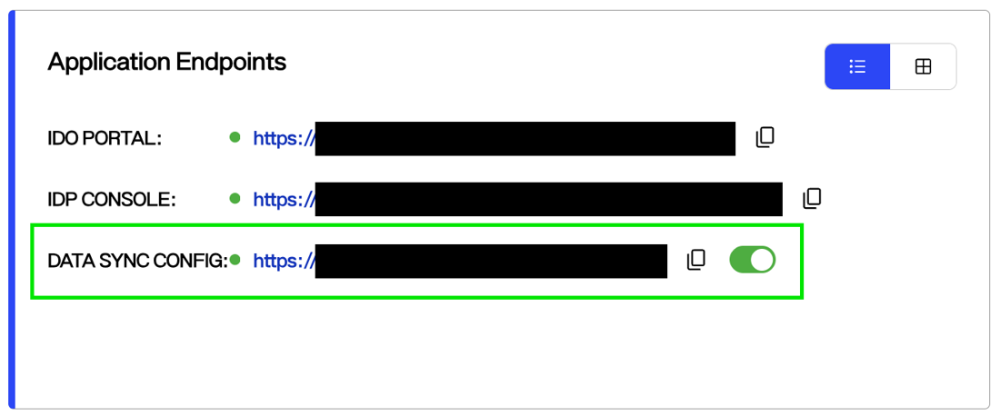
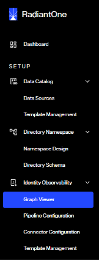
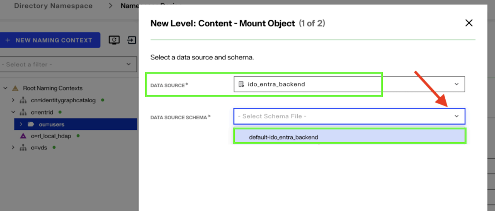

## Overview

This document provides a high-level overview of steps to configure, deploy, and monitor data sources and pipelines in Identity Observability.

## 1. Install the Identity Data Platform

Identity Observability is a capability in the Identity Data Platform, which is offered as a SaaS service via Radiant Logic's Environment Operations Center. Refer to the [installation steps guide](../installation/installation-steps/) to learn how to install and access Identity Observability.

You can access Identity Observability's services (main Identity Observability Portal, IDP console to manage users and roles and Data Sync Config to connect your data) by [logging into the application
endpoints](../installation/installation-steps/#log-in-to-identity-observability-endpoints) that appear on your application's overview page.




## 2. Connect to a Data Source

Login to data sync config URL using "cn=Directory Manager" as the username and the password you set during the application installation.

Once you login to the data sync config URL, you will see an interface for data configuration. This interface includes various features such as Graph Viewer, Pipeline Configuration, Connector
Configuration, and Template Configuration.




The Graph Viewer visualizes data schemas with vertices, edges, and attributes, and includes a filter panel for focused analysis. Template Management uses predefined, generic templates like ad_template_v1 for AD, which can be overloaded in the pipeline but not modified directly. <br>

Pipeline Configuration manages template use, mapping, and reconciliation of data sources.

After logging into the config sync URL, navigate to Data Sources and click New to create a new data source. You can use various types of data sources:

- **LDAP or Active Directory (AD):** Easiest options for getting started.

- **Custom data sources:** Supported via **virtualization** and **periodic cache refresh** in Data Sync Config, which acts as an intermediary layer. You can also read CSV files, LDIF files, or LDAP directories as scheduled snapshots with [Data-Dock](./data-dock.md).

- **Flat files (CSV):** Supported through the Relique CSV JDBC driver. Refer to [How to set up the Relique CSV JDBC Driver](https://support.radiantlogic.com/hc/en-us/articles/7944431689364-How-to-setup-the-Relique-CSV-JDBC-Driver-in-IDDM-7-4) for details.

> When you extract the schema of a CSV file, verify that all columns are present. If a column is empty and is not the last column in the file, the CSV reader stops at that column and all following columns are missing from the schema.

Refer to the [Creating Entra ID Data Source](./datasource-examples/entra-id.md) and [Creating AD Data Source](./datasource-examples/active-directory.md) examples to learn how to create data sources. 

#### Connect on-premises data sources

If your data source is behind a firewall or hosted on premises, connect it through the **Secure Data Connector (SDC)**. The SDC is a lightweight agent installed in your network. It opens an outbound, encrypted tunnel to Data Sync Config, so no inbound firewall rules or VPN are required. Once the SDC is registered, it can be used as the transport for any supported data source type.

#### Enable persistent cache

Identity Observability detects identity changes (new accounts, modified attributes, deleted entries) from the Data Sync Config changelog. The changelog is only generated when a **persistent cache** is enabled on the identity view, so persistent cache is mandatory for every view that Identity Observability reads.

Two cache refresh modes are available:

- **Real-time refresh:** Uses a capture connector on the backend to propagate changes as soon as they occur. Use this mode whenever the data source supports it.
- **Periodic refresh:** Polls the backend at a defined interval. Use this mode for backends that don't support real-time connectors, such as CSV files and some cloud APIs.

> Do not set the periodic refresh interval too low. If the interval is shorter than the time needed to process a refresh, refreshes queue up and degrade performance. Start with an interval of 15 to 30 minutes and adjust it based on observed processing times.

Refer to [Persistent Cache](https://developer.radiantlogic.com/idm/v8.1/tuning/persistent-cache/) for configuration steps.

#### Create data sources for Identity Observability

Pipelines should read from the cached local Data Sync Config namespace rather than from the backend directly. This way, pipelines consume data that is already normalized and filtered, and the load on the backend is reduced.

For each application or repository, duplicate the default **VDS** data source and update its **base DN** to point to the matching naming context in the local namespace. Name each copy `eoc-<application_name>`, for example `eoc-activedirectory` or `eoc-workday`. Reference these data sources in the `datasource` setting of your pipeline source objects.

## 3. Configure Data Pipeline

The next step is to configure the data pipeline to map your organization's identity data into the platform.

Keep in mind that the data will follow a specific flow as represented the schema below:




Begin by identifying the entities you will work with. Once you've identified your entities, familiarize yourself with the data model. Focus on **core objects** such as accounts and groups first.

The concepts related to JSON model representation are described below.

  | **Concept**               | **Description**                                                                                     |
|---------------------------|-----------------------------------------------------------------------------------------------------|
| **Concepts (Vertices)**   | Logical groupings of tags with a main tag and optional additional tags. The schema defines incoming and outgoing edges. |
| **Tags**                  | Logical grouping of properties.                                                                     |
| **Edges**                 | Relationships between concepts/vertices. They can also hold properties.                             |
| **Properties**            | Key-value pairs associated with concepts or edges.                                                  |
| **external_identifier**   | The ID used to join the entity with other data sources. In LDAP, this is typically the dn.          |
| **displayname**           | Mandatory. Used as the entity's display name in the Identity Observability UI.                     |
| **dn**                    | Automatically populated by the pipeline engine.                                                     |

####  Identifiers

Every entity mapped in *Identity Observability* requires an **invariant ID**.

Avoid using dn (Distinguished Name) since it can change through modifyRdn operations.

Instead, use one of the following:

- **objectGUID** (for AD)

- **UUID** or **EntryUUID** (for LDAP)

- A **custom composite key** (as a last resort)

#### Attribute naming

Use lowercase letters and underscores only (for example, `repository_name`) for the meta-attributes and computed attributes you define. Uppercase characters in attribute names can prevent attributes from resolving or edge link conditions from matching.

When an attribute is used in an edge link condition, normalize its value with the `normalizeValue` function so that both sides of the condition use the same casing. Refer to [Included functions](./functions.md) for examples.

> Some attributes are mandatory and must be included in your data mapping. These attributes are listed in the tables below. 

#### Identities

| **Attribute** | **Default value** |
|---------------|-------------------|
| **Active**    | true              |
| **Internal**  | true              |


Active and Internal flags must always be set. Default is true if no value is provided by the backend.

When identities leave the company or are no longer present in the backend, the Active status should be set to false. All identities must belong to an identity type repository.

> There is currently no standardized way to retrieve the manager, whether interpersonal or departmental. It is recommended to collect management information.

####  Accounts

| **RealTime Observability attribute** | **Audit & Compliance attribute** | **Default value** | **Unique** | **Non-null** |
|--------------------------------------|----------------------------------|--------------------|-------------|---------------|
| disabled                             |                                  | false              |             | **X**         |
| identifier                           | Identifier                       |                    | **X**       | **X**         |


The Disabled flag must always be set. Default is false if no value is provided by the backend.

The Identifier must be unique within a repository. It is recommended to use the attribute mapped to the vertex-id for the identifier.

If the Reconciliation type is set to "service", the account is considered a technical account. The attribute "reconciliation_service_reason" can be used to store the purpose of the technical account (e.g., training, testing).

The account is considered a user account if there is an "is_owned_by" edge to an identity. To verify if the identity has left the company, check the Active flag of the identity, not the account.

All accounts must belong to an account type repository.

#### Groups

| **RealTime Observability attribute** | **Audit & Compliance attribute** | **Unique** | **Non-null** |
|--------------------------------------|----------------------------------|------------|---------------|
| Name                                 | Code                             | **X**      | **X**         |


The **Name** must be unique within a repository. It is recommended to use the attribute mapped to the **vertex-id** for the identifier. The **group type** must be populated in the pipeline.

#### Permissions

| **Identity Observability attribute** | **Identity Analytics attribute** | **Possible values**    | **Default** |
|-------------------|-------------------|-------------------------|-------------|
| Type              | Type              | Role, Activity          | Role        |

Permission must be unique for each application. Each permission must be linked to only one application.

The permission, resource type, and family must be defined in the pipeline.

#### Resources

| **Identity Observability attribute** | **Identity Analytics attribute** | **Possible values**                  | **Default** |
|-------------------|-------------------|--------------------------------------|-------------|
| Type              | Type              | 'Profile', 'Server', 'Filesystem'    | Profile     |

All resources must belong to a repository. The repository must be the same one that contains the accounts and groups associated with the resource.

Example: if the accounts and groups of a resource are mapped in an AD repository, the repository value must be the AD repository, not the resource.

#### Repository

| **Identity Observability attribute** | **Values**               |
|-------------------|--------------------------|
| Type              | Accounts \| Identities   |


To leverage **MFA attributes** in accounts, the attribute mfa_enabled must be set on the repository containing the accounts.

#### Attributes required by the portal

The following attributes must be mapped for the Identity Observability Portal to work correctly (data visualization, Query Builder, and detail pages).

| **Entity** | **Attributes** |
|------------|----------------|
| Identity | `displayname`, `active`, `internal` |
| Account | `displayname`, `name`, `disabled` |
| Group | `displayname` |
| Permission | `displayname`, `type` |
| Resource | `displayname`, `type` |
| Repository | `name`, `displayname`, `is_mfa_capable`, `is_passwordless_capable`, `is_sspr_capable` |
| Department | `name`, `displayname` |

The repository capability flags `is_mfa_capable`, `is_passwordless_capable`, and `is_sspr_capable` default to No.

## 4. Deploy Configuration

Configuration templates define **reusable components** for the orchestrator.

Refer to the [graph pipeline template configuration](./template-configuration.md) and the [pipeline configuration example](./pipeline-configuration.md#configuration-example) for details on how to build and apply them effectively.

The pipeline starts when you click **APPLY** in the Pipeline Configuration editor. If you apply a configuration to a pipeline that has already run, follow the steps in [Re-apply a configuration](./pipeline-configuration.md#re-apply-a-configuration).

## 5. Monitor Configuration

After you apply the pipeline, open **Connector Configuration** to check the state of each connector:

| **State** | **Meaning** |
|-----------|-------------|
| `CONNECTOR_DEPLOYING` | The connector is starting. This is expected right after you apply the configuration. |
| `UPLOADING` | The connector is loading data. Large data loads may take additional time. |
| `RUNNING` | The connector is active and processing events. |
| `ERROR` | The connector has encountered a problem and is not processing events. |

If some connectors show an error state right after you apply the configuration, wait a moment and refresh the page.

Also check the **number of rejected events** for each connector. Rejected events are entries that could not be loaded into Identity Observability. Common causes are computed attribute failures, incorrect date formats, and missing mandatory attributes.

To follow processing progress, navigate to **Observation > Functional** in the Identity Observability portal. The graph shows processed events over time. When the curve flattens, all ingested data has been processed.

Next, enable controls and observations, and use the Query Builder or the Explore page to confirm that objects have been uploaded successfully. If the results appear empty, it indicates that the data upload has not been completed.

#### Load data into Audit & Compliance

Ensure that you upload data updates on a regular basis by navigating to **Admin > Settings > Real Time to Audit & Compliance**. From there, click **Load Data** to manually initiate data loading.

You can also define a schedule for data loading using a cron expression. For example, the following expression loads data every weekday at 4:00 AM:

```
0 4 * * 1-5
```

To optimize performance, define a purge schedule with a cron expression and a data retention value. Snapshots older than the retention period are deleted automatically.

> In Audit & Compliance, an account login must be unique within a repository. The account `name` attribute is mapped to the login. If several accounts in the same repository share the same `name` in Identity Observability, the data load fails. Resolve the duplicates before loading data again.

## Things to know

Change event listeners continuously collect identity data from backend sources (e.g. LDAP, Entra ID, Active Directory) and send it to the identity observability data store.

The **Pipeline Orchestrator** is the service that maps and transforms this data into the **Identity Observability (Identity Observability)** model, reconciling user and HR identities, identifying service accounts, and normalizing attributes
such as AD UAC values.

Processed data is stored in the Identity Observability graph and visualized in the **Identity Observability
Portal**. When **observations and controls** are active, the Observation Supervisor monitors related events, updates observed objects, and triggers alerts as needed.

Real-time data can be periodically loaded into the **Audit & Compliance database** for historical analysis.

Attribute updates or remediations made in the Identity Observability interface are routed back to source systems through the **write-back service or** applied directly to the real-time database if not mapped.

The **Remediation Notification Service** supports automated remediation through third-party systems such as ITSM tools, orchestrators, or email.

When deploying a new configuration, the orchestrator will automatically:

- Validate the configuration is valid and aligned with the graph schema.
- Verify the referenced datasources exist.
- Validate the attributes and object names are part of the datasource schema.
- Create and add flat views in the identity catalog naming context for each configured object.
- Create a default connector configuration for Identity Observability.
- If the connector configuration is complete, an initial upload is triggered automatically. Connector configurations are complete when they don't need human intervention to customize them.
- If the pipeline is not uploaded automatically, the pipeline state is flagged as `CONFIGURATION_INCOMPLETE`.
- After the upload of a pipeline is finished, the connector for that pipeline is restarted automatically.
- Create and deploy the graph pipelines that push the normalized data into the graph database following the configuration.
- The orchestrator keeps monitoring the state of the pipelines and the connectors, which is reported on the Prometheus metrics endpoint.

When applying a modified configuration, the orchestrator will:

- Validate the configuration changes are supported: only non-structural changes are supported, such as the addition of new source objects, the addition of new edges, and added or removed properties. Changing the datasource or the object name of an existing source object is considered a structural change and is not supported.
- Validate the configuration is aligned with the graph schema and the datasource schema.
- Deploy or undeploy the views in the identity catalog needed to support the new configuration.
- Identify the dependencies that need to be re-uploaded, which is common when adding a vertex or an edge that is based on a source object that was already processed in a previous run.
- Re-upload the dependencies and the pipeline.
- Back up the graph pipelines and redeploy them based on the new configuration.

When applying an empty configuration, the orchestrator will:

- Undeploy the identity catalog views.
- Undeploy the connectors.
- Undeploy the graph pipelines.
- Empty the graph database of all data.
